### Ph.D. @ Texas A&M | AI for Science | Ex-ML and Simulation Engineer Intern

Machine learning, computer vision and computational chemistry, from atomistic simulation to manufacturing data.

**Start here:**
* [SEM defect inspection](https://github.com/ryanlai666/SEM_Defect_Inspection) (computer vision)
* [Plasma-etch virtual metrology](https://github.com/ryanlai666/Plasma_Etch_VM) (data/ML)
* [Electrolyte design, *Nature Machine Intelligence*](https://github.com/ryanlai666/bamboo_mixer) (computational chemistry + ML)
* [IR spectra agent](https://github.com/ryanlai666/IR_spectra_agent) (LLM agent + atomistic ML)

<table>
  <tr>
    <td valign="top" width="60%">
      <h3>Tech Stack</h3>
      <ul>
        <li><b>Machine learning & computer vision</b>: PyTorch, CNN/ViT/DINOv2, YOLO, RT-DETR, Faster R-CNN, anomaly detection (PatchCore), GNN (GAT, EGT) and E(3)-equivariant networks, neural operators (FNO, DeepONet), PINNs, LightGBM, scikit-learn (RF, SVM), conformal prediction, reinforcement learning</li>
        <li><b>LLM & agents</b>: LangGraph, LangChain, Gemini API, RAG (FAISS)</li>
        <li><b>Computational chemistry</b>: VASP, Quantum ESPRESSO, CP2K, Gaussian, LAMMPS, GROMACS, ASE, RDKit, ML potentials (MACE, NequIP, DeePMD, UMA, Orb), GFN-xTB, kinetic Monte Carlo, ReaxFF, COMSOL, Ovito/VMD</li>
        <li><b>Software & data engineering</b>: Python, C++, CUDA, TensorRT, OpenMP, Rust, R, TypeScript/JavaScript, React, FastAPI, Flask, SQL (MySQL, PostgreSQL, SQLite), Neo4j, Pandas/NumPy, Docker, MLflow, GitHub Actions, Linux/Bash, Slurm/PBS, Tableau</li>
      </ul>
    </td>
    <td valign="top" width="40%">
      <h3>Stats</h3>
      
    </td>
  </tr>
</table>

---

## Semiconductor & electronics manufacturing
*Computer vision · data/ML · physics-informed ML*

<table>
  <tr>
    <td width="50%" valign="top">
      <a href="https://github.com/ryanlai666/SEM_Defect_Inspection">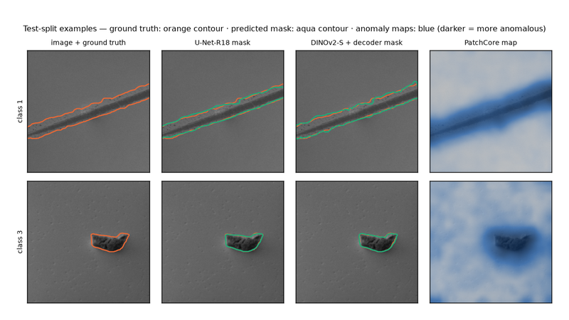</a> 
      <b><a href="https://github.com/ryanlai666/SEM_Defect_Inspection">SEM Defect Inspection</a></b> 
      Finds, segments and classifies defects in real SEM wafer images (Carinthia-S).
      <ul>
        <li>Segmentation Dice 0.95.</li>
        <li>Frozen DINOv2 features beat fine-tuning when labels are few.</li>
        <li>C++/CUDA/TensorRT anomaly engine: 250 img/s, 3.1× faster than PyTorch.</li>
      </ul>
      <code>Computer vision</code> <code>Anomaly detection</code> <code>PyTorch</code> <code>C++/CUDA</code> <code>TensorRT</code>
    </td>
    <td width="50%" valign="top">
      <a href="https://github.com/ryanlai666/PCB-Defect-CV-Benchmark">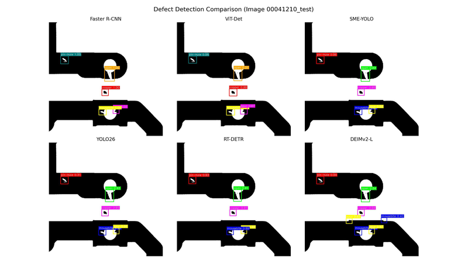</a> 
      <b><a href="https://github.com/ryanlai666/PCB-Defect-CV-Benchmark">PCB Defect CV Benchmark</a></b> 
      Six detectors compared on DeepPCB: Faster R-CNN, ViT-Det, YOLOv11n, YOLO26, RT-DETR-L and DEIMv2-L.
      <ul>
        <li>mAP@0.5 up to 0.975 (RT-DETR-L).</li>
        <li>YOLOv11n reaches 0.967 at 94 FPS.</li>
      </ul>
      <code>Computer vision</code> <code>Object detection</code> <code>PyTorch</code> <code>Ultralytics</code>
    </td>
  </tr>
  <tr>
    <td width="50%" valign="top">
      <a href="https://github.com/ryanlai666/Plasma_Etch_VM">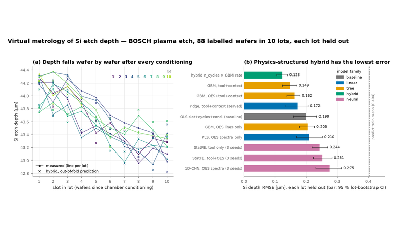</a> 
      <b><a href="https://github.com/ryanlai666/Plasma_Etch_VM">Plasma-Etch Virtual Metrology</a></b> 
      Predicts etch depth from optical emission spectra and tool sensors on an open plasma-etch dataset (96 wafers).
      <ul>
        <li>A physics-structured hybrid model reaches 0.12 µm RMSE on held-out lots.</li>
        <li>Calibrated 90 % prediction intervals.</li>
        <li>Served through FastAPI in Docker.</li>
      </ul>
      <code>Data/ML</code> <code>Sensor data</code> <code>LightGBM</code> <code>Conformal prediction</code> <code>FastAPI</code>
    </td>
    <td width="50%" valign="top">
      <a href="https://github.com/ryanlai666/Etch_Profile_Surrogate">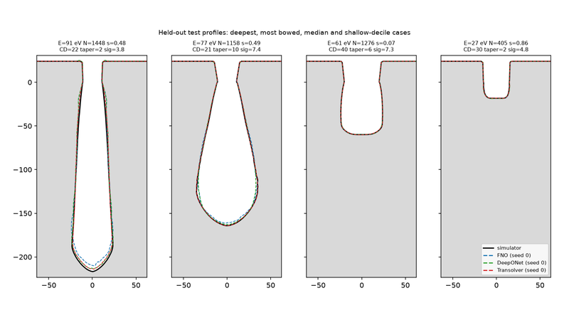</a> 
      <b><a href="https://github.com/ryanlai666/Etch_Profile_Surrogate">Etch Profile Surrogate</a></b> 
      Neural-operator surrogates (Transolver, FNO, DeepONet) trained on 4,096 etch simulations.
      <ul>
        <li>0.23 nm profile error.</li>
        <li>Conformal error bars.</li>
        <li>Active learning: 16 % lower error for the same simulation budget.</li>
        <li>Inverse recipe design and an inverse PINN.</li>
      </ul>
      <code>Physics-informed ML</code> <code>Neural operators</code> <code>PINN</code> <code>Uncertainty</code>
    </td>
  </tr>
  <tr>
    <td width="50%" valign="top">
      <a href="https://github.com/ryanlai666/plasma-surface-dynamics">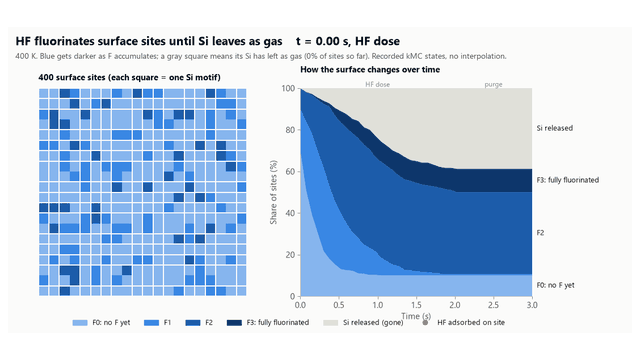</a> 
      <b><a href="https://github.com/ryanlai666/plasma-surface-dynamics">Plasma Surface Dynamics</a></b> 
      Reaction-network kinetic Monte Carlo (Python + C++) for atomic-layer etching of Si and Si₃N₄, backed by MACE potentials, NEB and DFT.
      <ul>
        <li>45 surface states, 55 events, 512 C++ trajectories.</li>
        <li>Every rate is gated by evidence.</li>
      </ul>
      <code>Kinetic Monte Carlo</code> <code>C++</code> <code>ML potentials</code> <code>DFT</code>
    </td>
    <td width="50%" valign="top"></td>
  </tr>
</table>

## Computational chemistry, materials & energy
*Atomistic ML · LLM agents · DFT*

<table>
  <tr>
    <td width="50%" valign="top">
      <a href="https://github.com/ryanlai666/bamboo_mixer">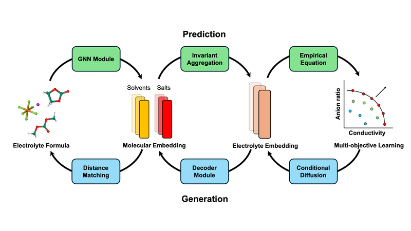</a> 
      <b><a href="https://github.com/ryanlai666/bamboo_mixer">Electrolyte Prediction & Generation (bamboo_mixer)</a></b> 
      Internship project, published in <i>Nature Machine Intelligence</i> (2026).
      <ul>
        <li>One model both predicts and generates liquid electrolyte formulations.</li>
        <li>Graph neural networks plus conditional diffusion.</li>
      </ul>
      <code>GNN</code> <code>Generative models</code> <code>Electrolytes</code> <code>PyTorch</code>
    </td>
    <td width="50%" valign="top">
      <a href="https://github.com/ryanlai666/IR_spectra_agent">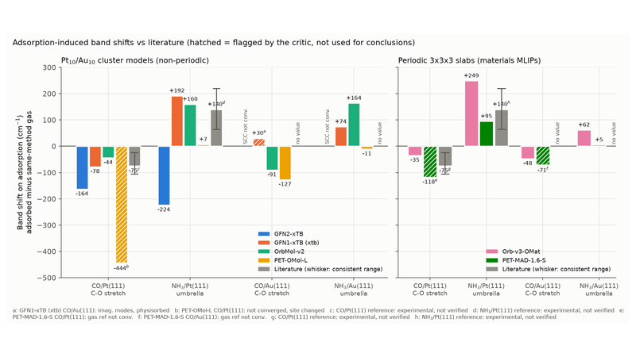</a> 
      <b><a href="https://github.com/ryanlai666/IR_spectra_agent">IR Spectra Agent</a></b> 
      A LangGraph agent turns a plain-language request into an IR-spectrum calculation for molecules and surface adsorbates.
      <ul>
        <li>Runs ML potentials (Meta UMA, Orb, PET) and GFN-xTB.</li>
        <li>Results are checked against measured spectra.</li>
        <li>20/20 correct plans on a labelled prompt set.</li>
      </ul>
      <code>LLM agent</code> <code>LangGraph</code> <code>ML potentials</code> <code>Spectroscopy</code>
    </td>
  </tr>
  <tr>
    <td width="50%" valign="top">
      <a href="https://github.com/ryanlai666/Semi-E3-MLIP">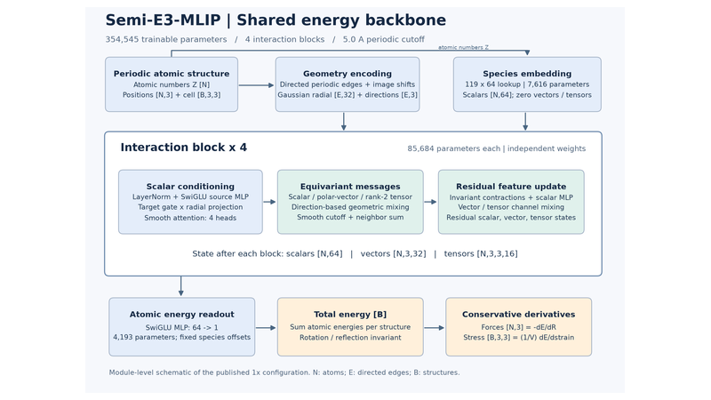</a> 
      <b><a href="https://github.com/ryanlai666/Semi-E3-MLIP">Semi-E3-MLIP</a></b> 
      A conservative E(3)-equivariant interatomic potential written from scratch in PyTorch, without e3nn or PyG.
      <ul>
        <li>Forces and stress derived from the energy.</li>
        <li>Handles periodic cells.</li>
        <li>Benchmarked across 20 metal and oxide systems.</li>
      </ul>
      <code>Equivariant GNN</code> <code>ML potentials</code> <code>PyTorch</code>
    </td>
    <td width="50%" valign="top">
      <a href="https://github.com/ryanlai666/MLIP_benchmark">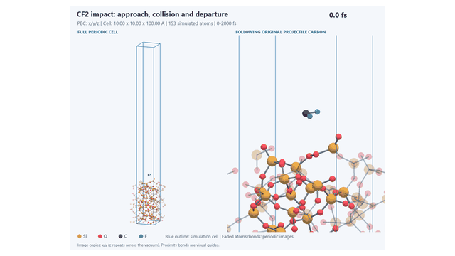</a> 
      <b><a href="https://github.com/ryanlai666/MLIP_benchmark">Semiconductor MLIP Benchmark</a></b> 
      Compares MACE, NequIP and DeePMD foundation potentials on Si crystals, surfaces and SiO₂/CFₓ etching DFT data.
      <ul>
        <li>Reactive reliability checks.</li>
        <li>GPU impact molecular dynamics.</li>
      </ul>
      <code>ML potentials</code> <code>Molecular dynamics</code> <code>ASE</code> <code>CUDA</code>
    </td>
  </tr>
  <tr>
    <td width="50%" valign="top">
      <a href="https://github.com/ryanlai666/Vasp-Wiki-Agent">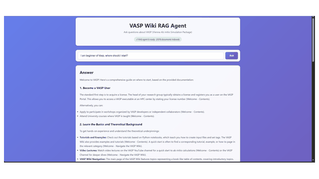</a> 
      <b><a href="https://github.com/ryanlai666/Vasp-Wiki-Agent">VASP Wiki Agent</a></b> 
      Retrieval-augmented assistant for the VASP DFT documentation.
      <ul>
        <li>Wiki crawler and FAISS semantic search.</li>
        <li>Gemini 2.5 Flash, with a FastAPI backend and React frontend.</li>
      </ul>
      <code>RAG</code> <code>LLM</code> <code>FastAPI</code> <code>React</code>
    </td>
    <td width="50%" valign="top"></td>
  </tr>
</table>

## Life science & data apps
*Cheminformatics · data visualization*

<table>
  <tr>
    <td width="50%" valign="top">
      <a href="https://github.com/ryanlai666/Openadmet_db_tableau">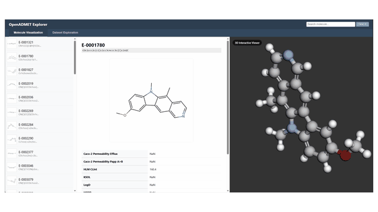</a> 
      <b><a href="https://github.com/ryanlai666/Openadmet_db_tableau">OpenADMET Explorer</a></b> 
      Interactive explorer for the OpenADMET drug-property dataset.
      <ul>
        <li>Molecule search.</li>
        <li>2D/3D structure viewer (RDKit, 3Dmol.js).</li>
        <li>Plotly statistics, served with FastAPI.</li>
      </ul>
      <code>Cheminformatics</code> <code>RDKit</code> <code>Data visualization</code> <code>FastAPI</code>
    </td>
    <td width="50%" valign="top"></td>
  </tr>
</table>

## Finance & time series
*Statistics · pattern recognition*

<table>
  <tr>
    <td width="50%" valign="top">
      <a href="https://github.com/ryanlai666/Statistics-Pattern-Recognition-and-Stock-Prediction">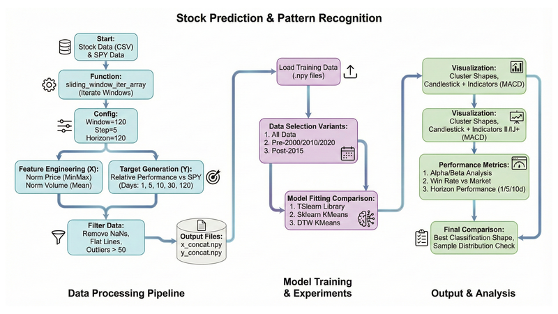</a> 
      <b><a href="https://github.com/ryanlai666/Statistics-Pattern-Recognition-and-Stock-Prediction">Stock Pattern Recognition</a></b> 
      Sliding-window pattern recognition on daily stock price and volume.
      <ul>
        <li>Normalized features.</li>
        <li>Time-series clustering (k-means, DTW).</li>
        <li>Performance measured relative to SPY.</li>
      </ul>
      <code>Time series</code> <code>Clustering</code> <code>Pattern recognition</code>
    </td>
    <td width="50%" valign="top">
      <a href="https://github.com/ryanlai666/ETF_TimeSeries_Analysis">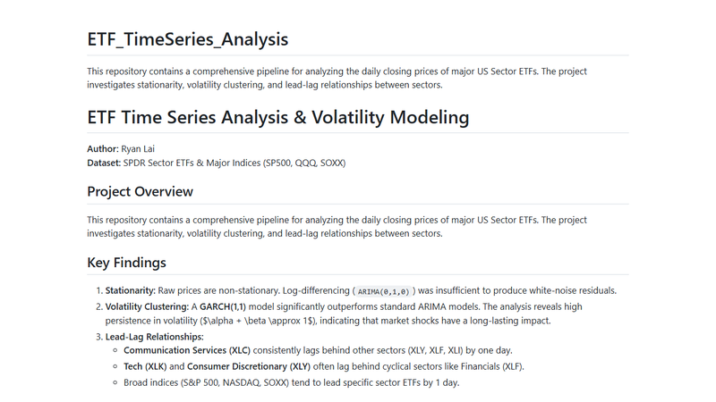</a> 
      <b><a href="https://github.com/ryanlai666/ETF_TimeSeries_Analysis">ETF Time Series & Volatility</a></b> 
      Stationarity, volatility clustering and lead-lag analysis of US sector ETFs.
      <ul>
        <li>GARCH(1,1) outperforms ARIMA.</li>
        <li>Broad indices lead sector ETFs by one day.</li>
      </ul>
      <code>Time series</code> <code>GARCH</code> <code>Statistics</code>
    </td>
  </tr>
</table>

## Reinforcement learning & simulation

<table>
  <tr>
    <td width="50%" valign="top">
      <a href="https://github.com/ryanlai666/lunar_bench">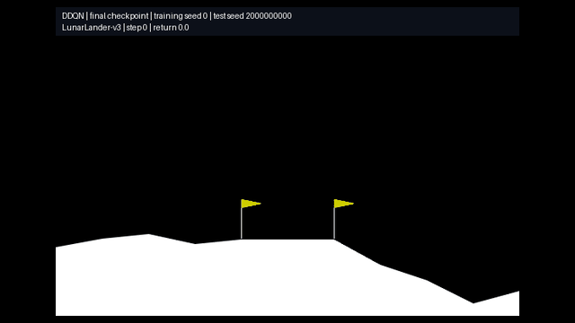</a> 
      <b><a href="https://github.com/ryanlai666/lunar_bench">LunarLander RL Benchmark</a></b> 
      PPO, A2C and Double DQN written from scratch in NumPy, run on LunarLander (Box2D) and on a batched Rust simulator.
      <ul>
        <li>Fixed budget, 3 seeds per method.</li>
        <li>Double DQN lands 70 % of episodes.</li>
      </ul>
      <code>Reinforcement learning</code> <code>NumPy</code> <code>Rust</code>
    </td>
    <td width="50%" valign="top"></td>
  </tr>
</table>

## Full-stack web apps

<table>
  <tr>
    <td width="50%" valign="top">
      <a href="https://github.com/ryanlai666/Meat_Cut">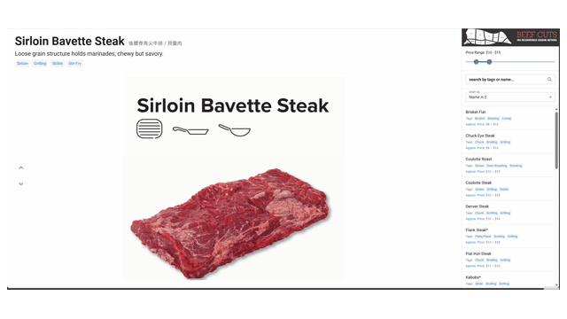</a> 
      <b><a href="https://github.com/ryanlai666/Meat_Cut">Meat Cut Guide</a></b> 
      Beef-cut guide app.
      <ul>
        <li>React frontend with search and an admin console.</li>
        <li>Node.js API, SQLite metadata and Google Drive image sync.</li>
      </ul>
      <code>React</code> <code>Node.js</code> <code>SQLite</code> <code>Google Drive API</code>
    </td>
    <td width="50%" valign="top">
      <a href="https://github.com/ryanlai666/resturant_app">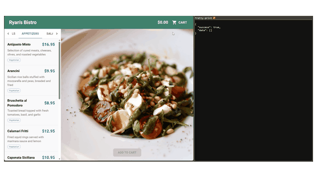</a> 
      <b><a href="https://github.com/ryanlai666/resturant_app">Restaurant Ordering App</a></b> 
      Restaurant ordering app.
      <ul>
        <li>React and Material UI menu, cart and order flow.</li>
        <li>Express backend with SQLite.</li>
      </ul>
      <code>TypeScript</code> <code>React</code> <code>Express</code> <code>SQLite</code>
    </td>
  </tr>
</table>

---

### Recent Publications
* *Nature Machine Intelligence* (2026). [A Unified Predictive and Generative Solution for Liquid Electrolyte Formulation](https://arxiv.org/abs/2504.18728)
* *JACS* (2025). [Lattice-Nitrogen-Mediated Chemistry Suppresses Hydrogen Evolution for Record Faradaic Efficiency... ](https://pubs.acs.org/doi/10.1021/jacs.5c09104)
* *JACS* (2025). [Linking Solvation Equilibrium Thermodynamics to Electrolyte Transport Kinetics for...](https://pubs.acs.org/doi/10.1021/jacs.5c00106)
* *JACS* (2025). [Vibrational Property Tuning of MXenes Revealed by Sublattice N Reactivity in Polar...](https://pubs.acs.org/doi/10.1021/jacs.4c13878)
